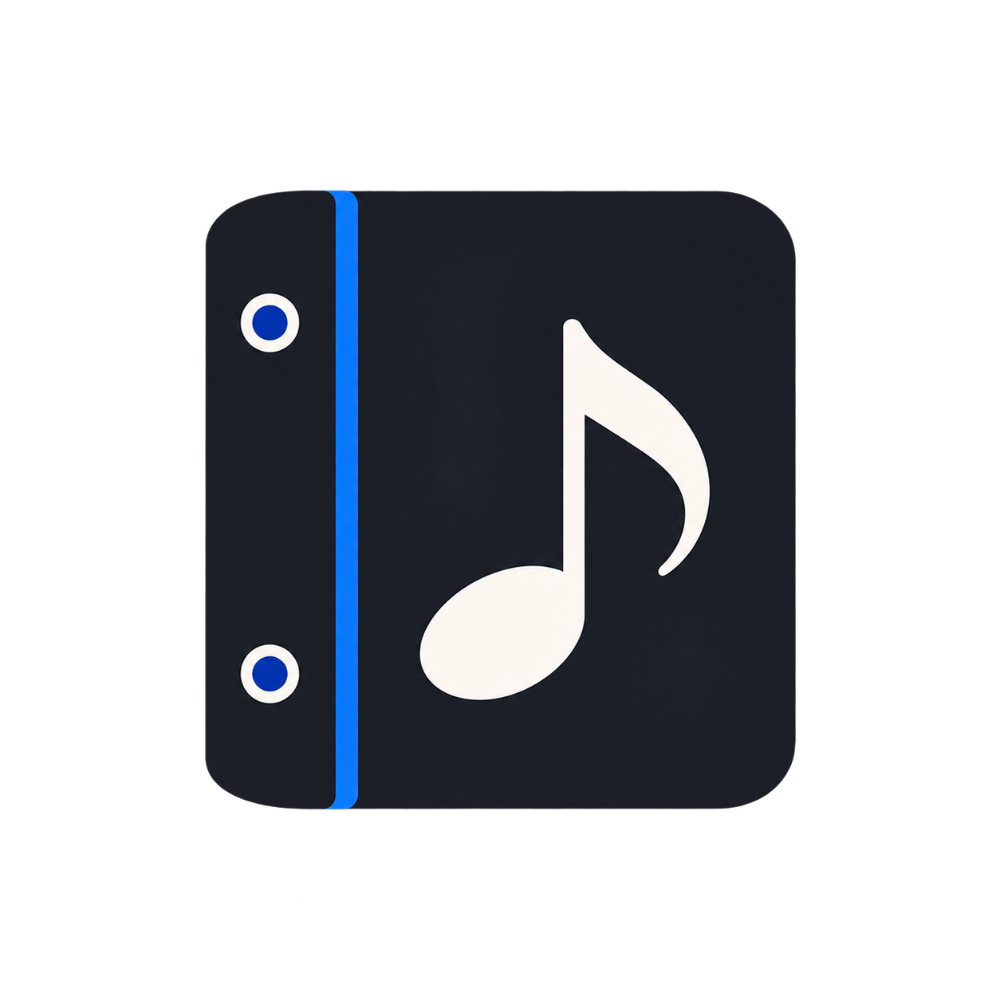

<p align="center">
  
</p>

<h1 align="center">MusiClass</h1>

<p align="center">
  A small desktop library for finding sheet music in physical binders.
</p>

MusiClass records where each score is stored, including its binder and page. Search is immediate, organization is visual, and all data remains on the computer.

## Features

- Fast search by title, composer, instrument, or binder
- Physical binder and page location for every score
- Drag and drop ordering for binders and scores
- Keyboard navigation and native context menus
- French and English interface with automatic locale detection
- Local storage with no account or required cloud service
- Custom desktop window for Windows and macOS

## Development

Requirements: Node.js 22 or later and npm.

```bash
npm install
npm run dev
```

Create a production web bundle with:

```bash
npm run build
```

## Desktop packages

```bash
npm run dist:win
npm run dist:mac
```

Windows packages must be built on Windows. macOS packages must be built on macOS.

GitHub Actions publishes both installers when a version tag is pushed:

```bash
git tag v0.1.0
git push origin v0.1.0
```

The release assets use stable names so the download website can always resolve the latest version:

```text
MusiClass.exe
MusiClass.dmg
```

## Data and privacy

The library is stored locally by Electron. MusiClass does not require an account, analytics, or a remote database.

## Related repository

The download website lives at [imlouak/web-musiclass](https://github.com/imlouak/web-musiclass).
